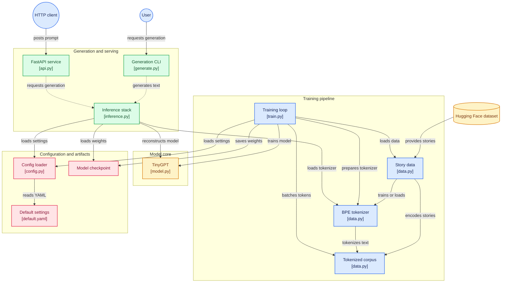

# Tiny LLM from Bedtime Stories

Learning-first project to build a GPT-style language model end-to-end using a Hugging Face bedtime-stories dataset.

[](https://gitdiagram.com/d-subrahmanyam/tiny-llm-bedtime?utm_source=readme&utm_medium=picture)

## Architecture (Mermaid)



## What you get

- Trainable tiny Transformer model (`TinyGPT`) in PyTorch
- Custom BPE tokenizer training + loading
- CLI inference (`tiny-llm-generate`)
- FastAPI server (`tiny-llm-api`)
- Concept docs + UML diagrams for study
- Checkpoint generation pipeline (`checkpoints/*.pt`), kept out of git due GitHub file-size limits

## Quick start (uv)

### 1) Install uv (one-time)

```bash
curl -LsSf https://astral.sh/uv/install.sh | sh
```

### 2) Install dependencies

```bash
uv sync
```

### 3) Train

```bash
uv run tiny-llm-train --config configs/default.yaml
```

Artifacts:
- tokenizer: `tokenizer.json`
- checkpoints: [`checkpoints/`](./checkpoints)

> Note: checkpoint `.pt` files are intentionally ignored in git (GitHub blocks files over 100MB).  
> Train locally to generate `checkpoints/step_005000.pt` before running inference/API commands below.

### 4) Generate from a checkpoint

```bash
uv run tiny-llm-generate \
  --config configs/default.yaml \
  --checkpoint checkpoints/step_005000.pt \
  --prompt "Once upon a moonlit night," \
  --max-new-tokens 120 \
  --temperature 0.7 \
  --top-k 20
```

### 5) Run the API

```bash
uv run tiny-llm-api \
  --config configs/default.yaml \
  --checkpoint checkpoints/step_005000.pt \
  --host 127.0.0.1 \
  --port 8000
```

Generate via API:

```bash
curl -X POST "http://127.0.0.1:8000/generate" \
  -H "Content-Type: application/json" \
  -d '{
    "prompt": "Once upon a moonlit night,",
    "max_new_tokens": 120,
    "temperature": 0.7,
    "top_k": 20
  }'
```

Interactive docs: `http://127.0.0.1:8000/docs`

## Download model from GitHub Releases

Release: `v0.1.0`  
URL: `https://github.com/d-subrahmanyam/tiny-llm-bedtime/releases/tag/v0.1.0`

### Option A: with GitHub CLI

```bash
gh release download v0.1.0 \
  -R d-subrahmanyam/tiny-llm-bedtime \
  -p "step_005000.pt" \
  -p "tokenizer.json" \
  -D .
mkdir -p checkpoints
mv step_005000.pt checkpoints/step_005000.pt
```

### Option B: with curl

```bash
curl -L -o checkpoints/step_005000.pt \
  https://github.com/d-subrahmanyam/tiny-llm-bedtime/releases/download/v0.1.0/step_005000.pt
curl -L -o tokenizer.json \
  https://github.com/d-subrahmanyam/tiny-llm-bedtime/releases/download/v0.1.0/tokenizer.json
```

## Config

Main config: [`configs/default.yaml`](./configs/default.yaml)

Important knobs:
- `data.dataset_name`, `data.text_field`
- `model.n_layer`, `model.n_embd`, `model.block_size`
- `training.max_steps`, `training.learning_rate`, `training.batch_size`

### Chosen baseline config (and why)

This project uses a deliberately small-but-realistic baseline so training stays practical on a laptop while still teaching core GPT behavior.

| Area | Value(s) in `configs/default.yaml` | Why this choice |
|---|---|---|
| Dataset | `gofilipa/bedtime_stories`, `stories`, `max_samples: 50000` | Story-style text matches the project goal and 50k rows keeps download/tokenization/training time manageable for iteration. |
| Tokenizer | Byte-level BPE, `vocab_size: 4096`, `min_frequency: 2`, special tokens `<\|pad\|>`, `<\|bos\|>`, `<\|eos\|>`, `<\|unk\|>` | Byte-level BPE is robust to uncommon words/spelling while keeping vocabulary small enough for a tiny model. `min_frequency=2` avoids spending vocab on one-off noise. |
| Context length | `block_size: 192` | Long enough to learn short story structure while keeping attention memory/compute reasonable (`O(T²)`). |
| Transformer width/depth | `n_layer: 6`, `n_head: 6`, `n_embd: 384` | Balanced tiny-GPT scale: enough capacity for coherent short continuations, still lightweight for educational runs. |
| Regularization | `dropout: 0.15`, `weight_decay: 0.1`, `bias: false` | Mild regularization helps small-data generalization and mirrors modern GPT-style simplifications. |
| Optimization | AdamW, `learning_rate: 2.5e-4`, `betas: [0.9, 0.95]`, `gradient_clip: 1.0`, `batch_size: 16` | Stable default for decoder-only Transformers; clipping helps prevent occasional gradient spikes. |
| Training budget | `max_steps: 5000` (step-based), eval every `200`, checkpoint every `1000` | Step-based scheduling is simple and reproducible with random-span batching. 5k steps is enough to see clear learning without long multi-hour runs. |

#### About "epochs" in this repo

Training is controlled by **optimizer steps** (`max_steps`) rather than fixed epochs.  
Because batches are sampled as random token spans from a long token stream, "epoch" is approximate:

\[
\text{approx\_epochs} \approx \frac{\text{max\_steps} \times \text{batch\_size} \times \text{block\_size}}{\text{num\_train\_tokens}}
\]

Use this formula with the `Train tokens: ...` value printed by training to estimate how many passes over data your run roughly represents.

## Build journey (stage-by-stage)

For new contributors, this is the fastest mental model of what happens in the repo:

| Stage | Goal | Main code | Output artifact |
|---|---|---|---|
| 1) Load data | Read bedtime stories from Hugging Face | `src/tiny_llm/data.py` (`load_texts`) | In-memory text list |
| 2) Train/load tokenizer | Build byte-level BPE vocab + special tokens | `src/tiny_llm/data.py` (`train_or_load_tokenizer`) | `tokenizer.json` |
| 3) Encode corpus | Convert stories to token IDs + append `<\|eos\|>` boundaries | `src/tiny_llm/data.py` (`encode_corpus`) | Long token tensor |
| 4) Build model | Initialize TinyGPT (embeddings, attention blocks, MLP, head) | `src/tiny_llm/model.py` | Initialized model |
| 5) Train loop | Sample random windows, compute next-token loss, optimize | `src/tiny_llm/train.py` | Updated model weights |
| 6) Evaluate/checkpoint | Log train/val loss, preview text, save snapshots | `src/tiny_llm/train.py` | `checkpoints/*.pt` |
| 7) Inference | Load checkpoint + tokenizer and generate text | `src/tiny_llm/inference.py`, `src/tiny_llm/generate.py` | Generated continuation |
| 8) Serve API | Expose generation endpoint over HTTP | `src/tiny_llm/api.py` | FastAPI service |

Deep dive doc map:

- Stages 1-3: [`docs/02_data_and_tokenization.md`](./docs/02_data_and_tokenization.md)
- Stage 4: [`docs/03_transformer_architecture.md`](./docs/03_transformer_architecture.md)
- Stages 5-6: [`docs/04_training_loop.md`](./docs/04_training_loop.md)
- Stage 7: [`docs/05_inference_and_sampling.md`](./docs/05_inference_and_sampling.md)
- Stage 8: [`docs/07_serving_api.md`](./docs/07_serving_api.md)
- End-to-end overview: [`docs/01_overview.md`](./docs/01_overview.md)

## Project layout

- [`src/tiny_llm/train.py`](./src/tiny_llm/train.py): training loop + checkpointing
- [`src/tiny_llm/model.py`](./src/tiny_llm/model.py): Transformer implementation
- [`src/tiny_llm/data.py`](./src/tiny_llm/data.py): dataset/tokenizer/batches
- [`src/tiny_llm/inference.py`](./src/tiny_llm/inference.py): checkpoint + tokenizer loading for inference
- [`src/tiny_llm/generate.py`](./src/tiny_llm/generate.py): CLI generation
- [`src/tiny_llm/api.py`](./src/tiny_llm/api.py): FastAPI app
- [`docs/`](./docs): learning notes and diagrams

## Learning docs

- [`docs/01_overview.md`](./docs/01_overview.md)
- [`docs/02_data_and_tokenization.md`](./docs/02_data_and_tokenization.md)
- [`docs/03_transformer_architecture.md`](./docs/03_transformer_architecture.md)
- [`docs/04_training_loop.md`](./docs/04_training_loop.md)
- [`docs/05_inference_and_sampling.md`](./docs/05_inference_and_sampling.md)
- [`docs/06_scaling_and_next_steps.md`](./docs/06_scaling_and_next_steps.md)
- [`docs/07_serving_api.md`](./docs/07_serving_api.md)
- [`docs/uml_diagrams.md`](./docs/uml_diagrams.md)

## Notes

- This is an educational tiny model; coherence is limited by data and model size.
- For better outputs, increase dataset size and training budget.
