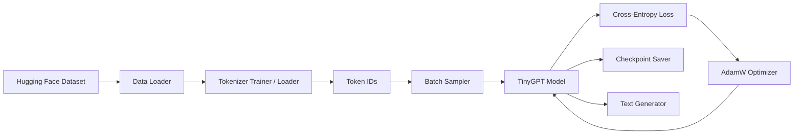
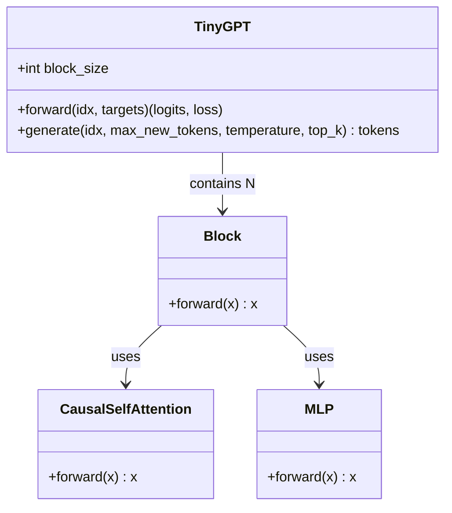
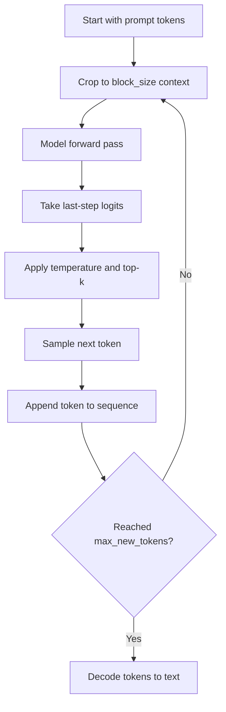
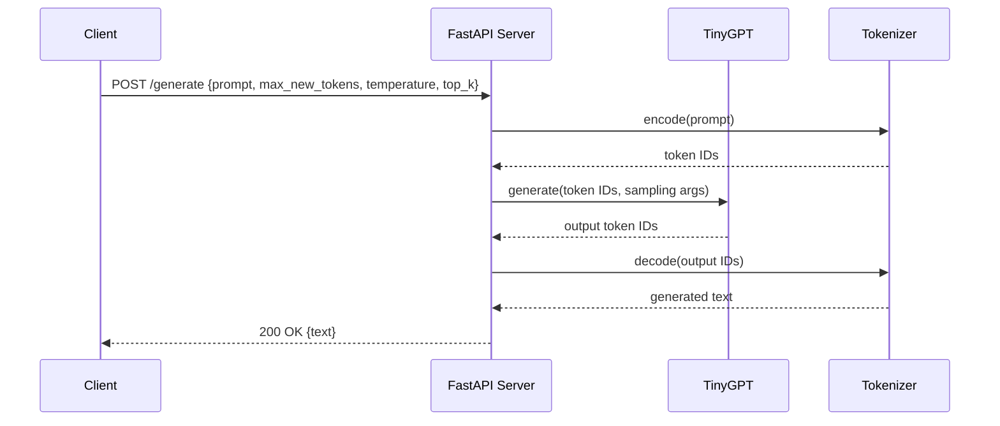

# UML Diagrams for the Tiny LLM Project

These diagrams use Mermaid syntax and can be rendered by many Markdown viewers.

## 1) Component Diagram (Pipeline Overview)



## 2) Class Diagram (Core Model Classes)



## 3) Sequence Diagram (Training Step)

```mermaid
sequenceDiagram
    participant Trainer
    participant Data as DataModule
    participant Model as TinyGPT
    participant Opt as AdamW

    Trainer->>Data: get_batch(train_tokens)
    Data-->>Trainer: x, y
    Trainer->>Model: forward(x, y)
    Model-->>Trainer: logits, loss
    Trainer->>Opt: zero_grad()
    Trainer->>Trainer: loss.backward()
    Trainer->>Trainer: clip_grad_norm_()
    Trainer->>Opt: step()
```

## 4) Activity Diagram (Generation)



## 5) Sequence Diagram (API Inference Request)


